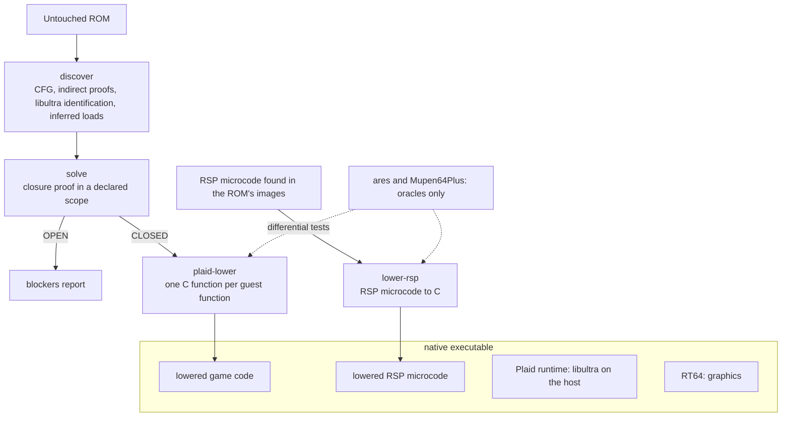
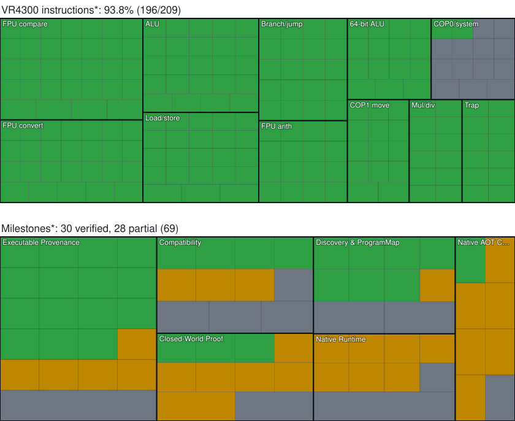
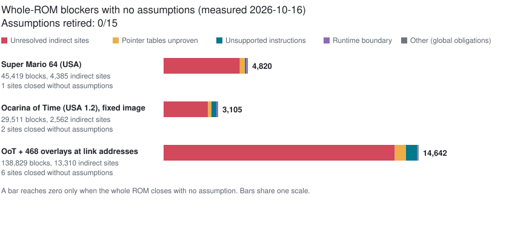

<div align="center">

# Plaid

**Turn an untouched Nintendo 64 ROM into a native program, with no emulator inside.**

[](docs/HISTORY.md) [](docs/PROGRESS.md) [](docs/STATUS.md)

[Status](docs/STATUS.md) · [Next steps](docs/NEXT.md) · [Architecture](docs/ARCHITECTURE.md) · [Decisions](docs/DECISIONS.md) · [Development](docs/DEVELOPMENT.md) · [Milestones](docs/PROGRESS.md)

</div>

Plaid is a research tool for automatic N64 ROM-to-native recompilation. You give it a ROM; it finds the game's code, proves what it can about it, translates it to C and links it into a native x86-64 or ARM64 program. The final build has no emulator, interpreter or JIT. Emulators (ares, Mupen64Plus) are used only while analysing and as test oracles. Anything Plaid cannot prove stops the game with a fault code instead of falling back to emulation.

## Where it stands

*As of ADR-0265, 2026-10-24. Every claim traces to [`docs/STATUS.md`](docs/STATUS.md) or an ADR in [`docs/DECISIONS.md`](docs/DECISIONS.md). These are finite test runs, not full playthroughs.*

| Game | Hand input | Native build | Longest native run | Next gap |
| --- | --- | --- | --- | --- |
| Super Mario 64 (USA) | code segment, 2 load files, a local symbol map for 3 names | ✅ | full-speed gameplay with input, EEPROM saves and audio, no stop in 90 s | infer its loads from the ROM |
| Majora's Mask (USA) | **none** | ??? | intro and Clock Town attract scene, 90 s, fault 0, audio (ADR-0187, ADR-0189); current main: 60 s, VI 3563, fault 0 after the frame-pin fix (ADR-0239) | longer play |
| F-Zero X (USA) | **none** | ✅ | 65 s races with compiled graphics microcode and audio, fault 0 (ADR-0186); current main: 20 s with `--rsp-gfx`, fault 0, now built through residual dispatch (1 open blocker) | longer play |
| Banjo-Kazooie (USA) (Rev 1) | **none** | 🟨 residual dispatch, 2 sites | 60 s: Nintendo opening and title, audio, fault 0; puzzle transitions in 75 s runs (ADR-0200, ADR-0201); current main: 60 s, VI 3568, fault 0 (ADR-0240) | re-prove the 2 table jumps lost in 94a4d7cb |
| Paper Mario (USA) | **none** | 🟨 builds by default with residual dispatch (ADR-0233) | 60 s: storybook intro, VI 3590, audio, fault 0 (ADR-0230); a fresh default build runs 30 s with fault 0 again (ADR-0263); earlier 60 s runs stopped at VI 2908 on an undiscovered shared-slot occupant | find that code; prove 8 indirect jumps for `native_complete` |
| Ocarina of Time (USA 1.2) | **none** | ✅ ROM-only, 0 blockers | 60 s with scripted save load: VI 3596, fault 0; opening Link/Kokiri scene after NJPEG (ADR-0265) | longer play |
| GoldenEye 007 (USA) | **none** | refused | not reached: OPEN, 592 blockers (589 with residual dispatch): 48 `7f` engine pages now recovered, resolving 81 of 85 missing direct targets but exposing more code (ADR-0255) | unvisited engine pages, cross-page instructions, TLB refill/exception semantics |
| Mario Kart 64 (USA) | **none** | 🟨 residual dispatch, 2 sites | 60 s with compiled graphics microcode and audio: VI 2762, 1270 graphics / 2635 audio tasks, fault 0 (ADR-0246) | prove the 2 residual sites; longer play |
| Star Fox 64 (USA) (Rev 1) | **none** | 🟨 residual dispatch, 8 sites | 30 s from the ROM alone: VI 1798, 945 graphics / 1730 audio tasks, fault 0 (ADR-0256, ADR-0257); borders clean since ADR-0266 | prove the 8 residual sites; longer play |
| Rogue Squadron (USA) | **none** | 🟨 builds with residual dispatch, 16 sites (ADR-0278) | copyright, logos, film intro and the SELECT GAME menu render natively (`--press 0x1000@600:4 --press 0x1000@1000:4 --press 0x1000@1200:4 --press 0x1000@1500:4`); name entry faults 11 at `80013408`; runs slower than full speed (VI p95 91 ms) | name-entry FR1 fault; native LLE RSP speed; missions |
| Mario Party 2 (USA) | **none** | 🟨 builds with residual dispatch, 8 sites | 30 s from the ROM alone with scripted Start/A: HUDSON logo to destination selection, VI 1798, fault 0 (ADR-0268, ADR-0269) | prove the 8 residual sites; board gameplay; the 476 s analysis |

"Native build ✅" means analysis is `CLOSED` under a declared scope (usually `--address-taken`) and `native.py` emits the executable. Since ADR-0233, `native.py` also builds by default when the only open items are indirect jumps it cannot prove: they go through a fail-closed run-time lookup over the translated code (still no emulation), and `native-manifest.json` records `native_complete: false`. `--strict` builds only proven maps.

### What is proven and what is assumed

- **Instructions.** Every VR4300 form Plaid lowers and all 119 RSP instructions match the pinned ares interpreter in differential tests. The chart under [Coverage](#coverage) has the breakdown.
- **Whole programs.** No ROM is yet proven complete with zero assumptions: **0 of 16** assumptions are retired. 13 of the 16 are checked while the game runs and stop it with a fault code if broken (for example, an indirect jump reaching an unknown target, or FPU code running in the wrong `Status.FR` mode, ADR-0234). 3 are trusted without a check: interrupts, DMA and the RSP are left out of the analysis (2); libultra is replaced by Plaid's own runtime (13); and three SM64 function names come from a symbol map (14). The [ledger](#assumption-ledger) lists all 16.

### Recent landings

| ADR | Commit | What |
| --- | --- | --- |
| 0278 | `ac22e04b` | Create Dirty Exclusive over a lost cache line is accepted with per-byte unknown tracking (checked against ares); RT64 shows non-square framebuffers at the right aspect; native RSP tasks hand off to the renderer once instead of per command (+65% VIs in 30 s). Rogue Squadron reaches SELECT GAME |
| 0277 | `03864220` | Jump-table bases survive register renames (`ADDIU` copies), and two RSP discovery gaps closed (51 RSP candidates, was 27). Rogue Squadron reaches the N64 logo |
| 0276 | `92d0733c` | `Status.FR` can switch at run time: FR mode follows data flow from Status writes over one canonical FPR file (12 full-state ares comparisons); RSP RAM scans cached (20,000 RDP calls 23.3 s -> 0.34 s). Rogue Squadron VI 114 -> 351 |
| 0275 | `57805a18` | Raw-overlay protection covers emitted instructions and dispatch inputs, not mutable string data (checked against ares). Rogue Squadron shows its copyright screen |
| 0274 | `7db712ec` | Packed RSP overlays are discovered (27 texts, was 21); unknown graphics microcode automatically runs as native LLE (a real task matches ares over 2,694 instructions). Rogue Squadron VI 1 -> 105 |
| 0273 | `33366296` | SDK PI-manager, yield and SP-task-load variants bind to the runtime; Rogue Squadron reaches its first graphics task |
| 0272 | `06337ff6` | SDK thread-dispatch variants are recognised by structure and bound to the host scheduler; Rogue Squadron starts its threads |
| 0271 | `890e21b7` | `CACHE` Create Dirty Exclusive allocates a line without filling it; unknown bytes fail closed until stored (checked against ares) |
| 0270 | `1e1d6771` | Statically untaken branches (`BLTZAL $zero`) and data in alternate overlay copies no longer create required targets; Rogue Squadron blockers 13 -> 0, first executable |
| 0269 | `aab10e1d` | Load refinement applies the same catalog trimming as discovery; Mario Party 2 builds from the ROM alone without retained loads |
| 0268 | `47de0d34` | Re-creating a destroyed thread retires its parked host and coroutine contexts instead of joining under the scheduler lock; Mario Party 2 reaches destination selection |
| 0267 | `37fb6706` | Catalog overlays are bound by content instead of being shadowed by fixed replay text; Mario Party 2 VI 8 -> 520 with fault 0 |
| 0266 | `5b00eb84` | RT64 fill clears are clipped to the RDP scissor; Star Fox 64's uncleared borders (tiled star trails) are fixed, frame interior unchanged |
| 0265 | `3b94f6c0` | RSP boots that patch themselves and the NJPEG task program are discovered from the ROM (checked against ares); Ocarina of Time plays 60 s through a scripted save load |
| 0264 | `2447e9a0` | PI load descriptors built in code are recognised by structure (`end == ram + size`) and bound by content; Rogue Squadron covers 39,550 -> 50,862 blocks |
| 0263 | `72ac595c` | Catalog overlays no longer replace validated `segment` slots; fixes the Paper Mario regression from 0258 (fault 3 at VI 2) |
| 0262 | `ed3f421e` | setjmp/longjmp coroutines run natively on host stacks; Mario Party 2 VI 2 -> 8 |
| 0261 | `70f401df` | A lui/addiu constant pair ends where its register is rewritten; Rogue Squadron blockers 140 -> 5 |
| 0260 | `243d051c` | COP0 WatchLo modelled while disarmed; `__osGetCause` is a runtime function. Mario Party 2 passes `osInitialize` |
| 0259 | `56b88a6d` | `CACHE` lowers onto the modelled D-cache; I-cache forms are no-ops and discarded dirty lines fail closed (checked against ares) |
| 0258 | `c9726afb` | Overlays discovered from linker segment tables; slots packed above every load. Mario Party 2 blockers 301 -> 0 with 0259 |
| 0256, 0257 | `aa8b5f18` | SP-memory residual targets fault instead of blocking; libultra dev-board stubs; catalog overlay verifiers relocate pointer tables. Star Fox 64 runs 30 s with fault 0 |
| 0255 | `d0f8bcf7` | Mapped page sources recovered for GoldenEye's `7f` engine: 48 pages, 81 of 85 missing direct targets resolved (blockers rise to 592 as more code is exposed) |
| 0252 | `714e1275` | Overlays are discovered from DMA catalogs and scene descriptors (MIO0 or raw); Star Fox 64 blockers 296 -> 8, 1 with residual dispatch |
| 0254 | `dc6e8664` | Analysis-time ares runs natively on Windows (MinGW) instead of in WSL; Banjo-Kazooie analysis is byte-identical and replays are about 3x faster |
| 0253 | `a0dbaf22` | RSP boot loaders that jump and short task programs are recognized; Ocarina of Time runs 30 s from the ROM alone with fault 0 |
| 0251 | `42887dfa` | Jump-table candidates whose bytes overlap decoded code stay unresolved instead of adding false targets; Rogue Squadron residual blockers 184 -> 151 |
| 0250 | `0cb6a044` | Initialized table data recovered from the boot replay, kept as data and checked natively where it is used; GoldenEye blockers 338 -> 175 |
| 0249 | `36dacb92` | Profiled hot spots removed: solve 4.2 -> 2.65 s, discovery on every core, ares harvest replays 77 -> 61 s; Banjo-Kazooie first build 282 s, outputs identical |
| 0248 | `b4fcfc55` | Rebuilds reuse identical identify/discover/solve runs: Banjo-Kazooie rebuilds in 38 s (was 109 s), byte-identical; the local gate runs in 4 min (was 25) |
| 0247 | `721bce7f` | Builds are faster: ares replays are cached by exact inputs and the oracle is built at -O2; Banjo-Kazooie builds in 335 s (was 606 s), 109 s when rebuilt |
| 0244 | `19c2cf4` | A jump through a saved copy of `$ra` is a checked return, like `jr $ra` |
| 0246 | `e688c5c` | Overlays also run inside their resident microcode; Mario Kart 64 runs 60 s with fault 0 |
| 0245 | `deaa5d4` | Corrects 0240: every RSP text is kept for execution, one per indistinguishable group is matched; F-Zero X with compiled graphics microcode runs again |
| 0243 | `f710541` | Short RSP overlays named by an overlay table become candidates; Mario Kart 64 renders and plays audio for ~9 s |
| 0242 | `8dfa72b` | EntryHi comes from the boot replay and survives runtime calls; Mario Kart 64 gets through startup to its first graphics task |
| 0241 | `0d6f52b` | The PIF accepts a game's own terminate-boot command, as ares does; Mario Kart 64 moves to an EntryHi read |
| 0240 | `9e97f24` | RSP microcode candidates the runtime cannot tell apart count once; fixes the Banjo-Kazooie VI 11 stop |
| 0238 | `f9ec01f` | `CFC1`/`CTC1` need only the FPU enabled, not a matching FR mode (matches ares); Mario Kart 64 moves past fault 11 to a PIF RAM write |
| 0239 | `c63eb84` | Suspended native frames pin only the code they can still run; fixes the Majora's Mask VI 0 regression |
| 0237 | `0c4d9010` | Bounded ERET and aligned executable loads; MK64 builds with four residual sites, then faults 11 before VI; ISA 204/209 |
| 0236 | `438a0c2` | Replay-authenticated mapped instruction sources and guarded physical backing; GoldenEye reaches 3,716 blocks, both new games still refuse |
| 0235 | `e9b1521` | Seven checked COP0/TLB forms; mapped instruction discovery and exception/timer delivery remain open |
| 0234 | `76692ed` | Every FPU instruction checks `Status.FR` at run time (boot context FR = 1, threads FR = 0); FPU forms move from orange to amber |
| 0233 | `b65a162` | Residual run-time dispatch is the default build; `--strict` keeps proven-only builds; seven-ROM sweep recorded |
| 0231 | `78b0eda` | TLB host register effects bound into callee proofs; Paper Mario's 8 remaining indirect jumps classified (save/restore alias proofs, table-base initialization, stack lineage) |
| 0230 | `c3c1edb` | Code loaded into an already-covered memory slot is discovered; Paper Mario plays 60 s fault-free with audio |
| 0229 | `db99954` | Incomplete switch paths kept as candidates; Paper Mario VI 654 to 659 |
| 0227 | `c7ee4de` | Analysis replay watches relocated call sites at their run-time address; Paper Mario VI 648 to 654 |
| 0226 | `1f284c4` | Calls the replay observed are accepted as function entries; Paper Mario VI 4 to 648 |
| 0225 | `7d6ae3c` | RSP microcode found in RAM filled by cartridge DMA; Paper Mario's audio runs natively |
| 0223, 0224 | `23465c8`, `273d50e` | Unproven sites dispatch over their own candidates; DMA into TLB-mapped buffers |
| 0218..0222 | `0fa9c9a`..`1e93b08` | Validation-only residual dispatch, boot code capture, observed call roots |
| 0219 | `1ea8aff` | Shared CPU/RSP code-write gate; OoT passes its RSP self-patch |
| 0195..0200 | `76df640` | Banjo-Kazooie reaches its native intro |
| 0188 | `6758817` | RSP microcode derived from the ROM, with every fetch checked |

Older decisions: [`docs/DECISIONS.md`](docs/DECISIONS.md) and [`docs/HISTORY.md`](docs/HISTORY.md).

## How to play

You supply the ROM; ROMs are never committed. `python scripts/native.py <rom> --rt64 [--rsp-gfx]` builds the executable and writes a `Play <name>.cmd` launcher beside it. Built executables live in `target/rt64-shim/Release/` next to `plaid_rt64.dll` and `SDL2.dll`. For example, Majora's Mask:

```powershell
.\target\rt64-shim\Release\mm-rt64.exe --rom <your mm.z64> --flash <save.fla> --stop-at none
```

| Key | Button |
| --- | --- |
| X / C / Z | A / B / Z |
| Enter | START |
| Q / E | L / R |
| I / K / J / L | C-up / C-down / C-left / C-right |
| W / S / A / D | D-pad |
| Arrow keys | Control stick |

Saves: `--flash` for FlashRAM games, `--save` for EEPROM. `--press` scripts are ORed with the keyboard. Only Windows has been tested with RT64; only controller 1 works, with no rumble. Build details: [`runtime/README.md`](runtime/README.md).

## How it works



Nothing in the compiler or runtime is keyed to a game: no game names, addresses or patches. `scripts/native.py <rom>` runs the whole pipeline. It infers where the code is and what loads where from the ROM; pinned ares replays the boot at analysis time to find code the game builds or copies itself. Libultra functions are identified by signature and become calls into Plaid's C runtime ([`runtime/`](runtime/)): threads, message queues, timers, PI DMA, controllers, saves and RSP tasks. Graphics go through [RT64](https://github.com/rt64/rt64), either from display lists or, with `--rsp-gfx`, from the game's own graphics microcode compiled to C. Audio always runs the game's own RSP microcode compiled to C.

Known gaps:

- Overlay load bases are found at run time, not proven (assumption 12).
- The runtime covers the libultra functions these games call; a game calling one it lacks fails to link.
- Saves: 4 Kbit EEPROM, 256 Kbit SRAM, 1 Mbit FlashRAM. No 16 Kbit EEPROM; the Controller Pak always reports no pak.
- The ROM-derived RSP microcode registry is incomplete (OoT), and RSP tasks complete synchronously.

## Coverage

[](docs/PROGRESS.md)

<sub>**These bars cover instruction translation only. They do not mean a game works.** Green: matches ares with no conditions. Amber: matches ares, and the native code checks a condition at run time and faults if it fails (bounded COP0/TLB state, loads and stores, indirect jumps and returns, trapping arithmetic, traps, `BREAK`, and all COP1, which faults 11 unless `Status.FR = 0`). Orange: matches ares but relies on something nothing checks. Grey: not lowered (`TLBWR`, `SYSCALL`, `CACHE` and COP0 control moves); the seven COP0/TLB forms and bounded ERET are amber and fault 12 on unmodeled state; libultra's uses of them are replaced by Plaid's runtime. A form counts when it passes discovery, the solver and lowering in a test program (`plaid isa-coverage`) and matches ares in [the COP0 contract](runtime/test_cop0.py), [the ERET contract](runtime/test_eret.py) or [spike096](spikes/096-native-slice/); RSP instructions are checked in [spike097](spikes/097-rsp-slice/). The RSP "In a real game" bar is orange because the candidate registry and the solver's RSP policy are not proven, even though microcode is taken from the ROM with every fetch checked (ADR-0188). [Progress history](docs/HISTORY.md).</sub>

## Assumption ledger

<details>
<summary>Whole-ROM blockers and the 16 assumptions (generated by <code>tools/progress.py</code>)</summary>

<!-- assumptions:begin -->

### Distance to no-assumption CLOSED

[](docs/assumptions.json)

No commercial ROM is `CLOSED` whole-ROM without assumptions. Assumptions retired: **0/16**. Measured 2026-10-17 with `plaid solve <rom> <map> [scope]`; data in [`docs/assumptions.json`](docs/assumptions.json), generated by `tools/progress.py`.

| ROM | Blocks | Indirect sites closed with no assumption | Whole-ROM blockers | Scoped results |
| --- | --- | --- | --- | --- |
| Super Mario 64 (USA) | 45,419 | 1 of 4,385 | OPEN, 4,820 | `--guarded-ram` **OPEN** (91 blockers), 14 assumptions; `--address-taken` **CLOSED**, 15 assumptions |
| Ocarina of Time (USA 1.2), fixed image | 29,613 | 2 of 2,574 | OPEN, 3,120 | `--guarded-ram` **OPEN** (122 blockers), 12 assumptions; `--address-taken` **CLOSED**, 13 assumptions |
| OoT + 468 overlays at link addresses | 155,770 | 6 of 14,869 | OPEN, 16,338 | `--guarded-ram` **OPEN** (711 blockers), 13 assumptions; `--address-taken` **CLOSED**, 14 assumptions |
| Majora's Mask (USA) + overlays, inferred loads | 214,963 | 10 of 19,138 | OPEN, 21,313 | `--guarded-ram` **OPEN** (891 blockers), 13 assumptions; `--address-taken` **CLOSED**, 14 assumptions |
| F-Zero X (USA), inferred shared-slot alternates | 27,621 | 1 of 1,974 | OPEN, 2,995 | `--guarded-ram` **OPEN** (44 blockers), 13 assumptions; `--address-taken` **CLOSED**, 14 assumptions |

Whole-ROM blockers by class:

| Class | sm64 | oot | oot-overlays | mm | fzerox |
| --- | ---: | ---: | ---: | ---: | ---: |
| `unresolved_indirect_site` | 4,384 | 2,572 | 14,863 | 19,128 | 1,973 |
| `exception_or_unsupported_instruction` | 78 | 284 | 651 | 955 | 422 |
| `pointer_table_immutability_unproven` | 147 | 96 | 376 | 571 | 120 |
| `pointer_table_target_identity_unproven` | 147 | 96 | 376 | 571 | 120 |
| `unresolved_direct_target` | 0 | 0 | 0 | 0 | 162 |
| `unmapped_target` | 0 | 0 | 0 | 0 | 131 |
| `runtime_boundary_outside_scope` | 57 | 65 | 65 | 81 | 60 |
| `dynamic_effect_outside_scope` | 1 | 1 | 1 | 1 | 1 |
| `unmodeled_exception_paths` | 1 | 1 | 1 | 1 | 1 |
| `unproven_executable_universe` | 1 | 1 | 1 | 1 | 1 |
| `unproven_executable_write_policy` | 1 | 1 | 1 | 1 | 1 |
| `unproven_load_overlay_policy` | 1 | 1 | 1 | 1 | 1 |
| `unproven_rsp_policy` | 1 | 1 | 1 | 1 | 1 |
| `unsupported_execution_modes` | 1 | 1 | 1 | 1 | 1 |

Assumptions behind the SM64 `--address-taken` result. "Fault n" means the native artifact tests it at run time and aborts with that code; **unchecked** ones are trusted.

| # | Assumption | Run-time check | State | Retired when |
| ---: | --- | --- | --- | --- |
| 1 | Only declared image entries execute; code is immutable | fault 2/3 | assumed | model code writes (self-modifying code, overlay loads) and prove every executable byte's origin |
| 2 | Interrupts, exceptions, DMA, MMIO, overlays, RSP and external entries are excluded from analysis | **unchecked** | assumed | model them in the closure proof, or prove the HLE runtime equivalent; the runtime stands in for them today |
| 3 | 32-bit address model | fault 1 | assumed | model 64-bit addressing and the full TLB, or prove the game never leaves the 32-bit subset |
| 4 | Register calls reach only address-taken functions (1,341 in SM64) | fault 3 | assumed | prove each indirect site's target set by data flow, jump-table shape or points-to |
| 5 | Forwarded runtime-callback wrappers are entered only by their direct callers (ADR-0149) | fault 3 | assumed | prove the callback target at each wrapper call site |
| 6 | Return closure: each jr ra returns to its caller's continuation | fault 5 | assumed | prove return targets per function, including tail calls and stack-slot integrity |
| 7 | Guarded RAM data access: aligned RDRAM through KSEG0/KSEG1 or runtime-written TLB entries, no stores into code | fault 1/2/4 | assumed | prove each load and store address range |
| 8 | Jump tables are read-only | fault 2 | assumed | prove table immutability and target identity (pointer_table blockers) |
| 9 | COP1 usable with FR=0 (declared with --fr0) | fault 11 | assumed | model Status.CU1 and Status.FR from the game's own writes; today every COP1 instruction faults 11 unless the runtime-known mode is FR = 0 (libultra threads), and the IPL3 boot context is FR = 1 (ADR-0234) |
| 10 | COP1 stays in the modelled subset: no NaN, subnormal, out-of-range conversion or FPU exception | fault 7 | assumed | model FPU exceptions and the remaining operand classes |
| 11 | Declared loads place their bytes before the code runs | fault 8 | assumed | derive the loads from the ROM instead of declaring them by hand |
| 12 | Relocatable overlays run only where their relocated bytes verify; native frames pin each binding (ADR-0181/0187) | fault 2/3/8 | assumed | prove each overlay's load base and lifetime from the game's own loader |
| 13 | libultra runtime functions are host-provided (HLE) | **unchecked** | assumed | differential-test each HLE function against the game's own libultra; only scenario tests exist today |
| 14 | Three runtime names come only from a reference symbol map (osInitialize, osContInit, osEepromLongRead; ADR-0171) | **unchecked** | assumed | identify them from the ROM's own bytes |
| 15 | Trapping arithmetic never overflows | fault 6 | assumed | model the Overflow exception |
| 16 | BREAK is never executed | fault 9 | assumed | model the Breakpoint exception |

Inputs given by hand, outside the solver:

- Code segment ROM offset, address, size and entry point, given by hand for SM64 and OoT; inferred from the ROM for Majora's Mask and F-Zero X (boot address from the CIC, size from the entry stub's BSS clear; ADR-0183, ADR-0184)
- --loads files for executable loads, written by hand (SM64: 2, OoT: 2; Majora's Mask and F-Zero X: none). Without a file table, infer-loads finds segments from ROM ranges named in code; on SM64 it finds the engine segment but not goddard (ADR-0184)
- SM64 function identification uses a local decomp map
- Graphics use RT64 display-list HLE by default; --rsp-gfx executes compiled graphics microcode and gives its raw RDP commands to RT64 (ADR-0186)
- libultra runs as a host runtime (HLE)

<!-- assumptions:end -->

</details>

## Milestones

| # | Milestone | State |
| --- | --- | --- |
| 1 | Synthetic ROM to C to native, matching ares exactly | ✅ **done** (spike096) |
| 2 | SM64 discovery finds at least 99% of its functions | ✅ **done**: 99.03%, scored against a local decomp map (ADR-0152) |
| 3 | SM64 `CLOSED` under declared assumptions | ✅ **done**: 45,419 blocks, every assumption listed (ADR-0153..0156) |
| 4 | SM64 boots natively to its title screen | ✅ **done**, and further: gameplay at full speed, with input, saves and native audio (ADR-0159..0170) |
| 5 | Retire the assumptions one by one; more games from the ROM alone | 🟨 **in progress**: MM, F-Zero X and Banjo-Kazooie build from the ROM alone; Paper Mario runs as a validation build; 0 of 16 assumptions retired |

<details>
<summary><b>How SM64 got running: each stop and its fix</b></summary>

Nothing falls back to emulation, so every stop is a fail-closed fault at an exact guest PC. Each fix is a decision record with a differential test against ares.

| Stop | Cause | Fix |
| --- | --- | --- |
| First graphics task took 397 frames | every store scanned 45k code ranges | per-word protection map (ADR-0159) |
| `mtxf_lookat` fault 7 | libultra runs COP1 with Status.FR = 0 | FR = 0 register pairs (ADR-0160) |
| goddard reload, fault 2 | a reloaded segment was protected for good | loads re-verify after a write (ADR-0161) |
| goddard dynlists, fault 1 | data read through `osMapTLB` mappings | TLB-mapped data, with D-cache index aliasing (ADR-0162) |
| No picture | graphics tasks were only reported | RT64 bridge (ADR-0163) |
| Stuck at "PRESS START" | controller always idle | keyboard and scripted input (ADR-0164) |
| Half speed (33 VI/s) | Windows rounds 1 ms sleeps up to 15.6 ms | high-resolution timer and fixed VI deadlines (ADR-0166) |
| Silence | audio tasks completed without running | RSP scalar and vector microcode lowered to C (ADR-0167/0168) |
| "unlowered RSP code" | the boot microcode loads the audio microcode at run time | lowered IMEM snapshots (ADR-0169), later derived from the ROM (ADR-0188) |
| Audio microcode, fault 4 | it reads the RDP status register | an idle-RDP read, checked against ares (ADR-0169) |
| Audio ran 4% fast | `osAiGetLength` always read 0 | AI DMA timed as ares models it, played through SDL (ADR-0170) |

</details>

## Build

```bash
cargo test --locked --workspace
python scripts/test_cli.py
python runtime/test_runtime.py
python tools/progress.py --check
```

The full local gate, the native differential test and reference-lab setup are in [`docs/DEVELOPMENT.md`](docs/DEVELOPMENT.md).

## Credits

Plaid stands on other people's work. Each project below is pinned in [`refs.lock.toml`](refs.lock.toml) and its license is checked before any reuse; reuse decisions are recorded in [`docs/DECISIONS.md`](docs/DECISIONS.md) and [`docs/SOURCES.md`](docs/SOURCES.md).

| Project | What Plaid uses it for | How | License |
| --- | --- | --- | --- |
| [Rabbitizer](https://github.com/Decompollaborate/rabbitizer) | MIPS instruction decoder used by discovery | linked dependency | MIT |
| [spimdisasm](https://github.com/Decompollaborate/spimdisasm) | disassembly experiments for call and jump-table recovery | reference | MIT |
| [n64sym](https://github.com/shygoo/n64sym) | libultra function signatures; Plaid's matching rule follows its `TestSymbol` | signatures and a reimplemented rule | MIT |
| [N64Recomp](https://github.com/N64Recomp/N64Recomp) | the model of lowering MIPS to C, and of reimplemented runtime functions | reference and design | MIT |
| [RT64](https://github.com/rt64/rt64) | renders each game's display lists | built and linked into generated games | MIT |
| [ares](https://github.com/ares-emulator/ares) | accuracy oracle for CPU and RSP semantics | differential testing only, never linked into a native build | ISC |
| [Mupen64Plus](https://github.com/mupen64plus/mupen64plus-core) | instrumented discovery reference and second oracle | research instrument in `instruments/mupen/`, separately licensed | GPL-2.0-or-later |
| [n64-systemtest](https://github.com/lemmy-64/n64-systemtest) | hardware-behaviour test programs | test inputs | MIT |
| [Gopher64](https://github.com/gopher64/gopher64), [N64ModernRuntime](https://github.com/N64Recomp/N64ModernRuntime) | cross-checks of hardware and runtime behaviour | read only; no code copied or linked | GPL-3.0 |
| [SDL](https://www.libsdl.org/) | audio output and keyboard input in the runtime | linked at run time | zlib |
| Super Mario 64 decompilation project | a locally built symbol map, used to name three libultra functions and to score discovery recall | kept local; never committed or used to find code | CC0 |

Thank you to the authors and maintainers of all of them. Super Mario 64, Ocarina of Time, Majora's Mask and Mario Party 2 are the property of their owners; Plaid is not affiliated with Nintendo.

## Disclaimer

This project is intended for interoperability, research, and preservation purposes. It does not include, distribute, or require copyrighted software, firmware, keys, or proprietary libraries. Users are responsible for obtaining and using any ROM in accordance with applicable laws.

## License

Plaid is licensed under either of [MIT](LICENSE-MIT) or [Apache-2.0](LICENSE-APACHE), at your option. The Mupen64Plus instrumentation in `instruments/mupen/` is a separately licensed GPL research instrument (see its `COPYING`) and is not part of Plaid's compiler or runtime. Reused third-party logic is credited where it is used.
