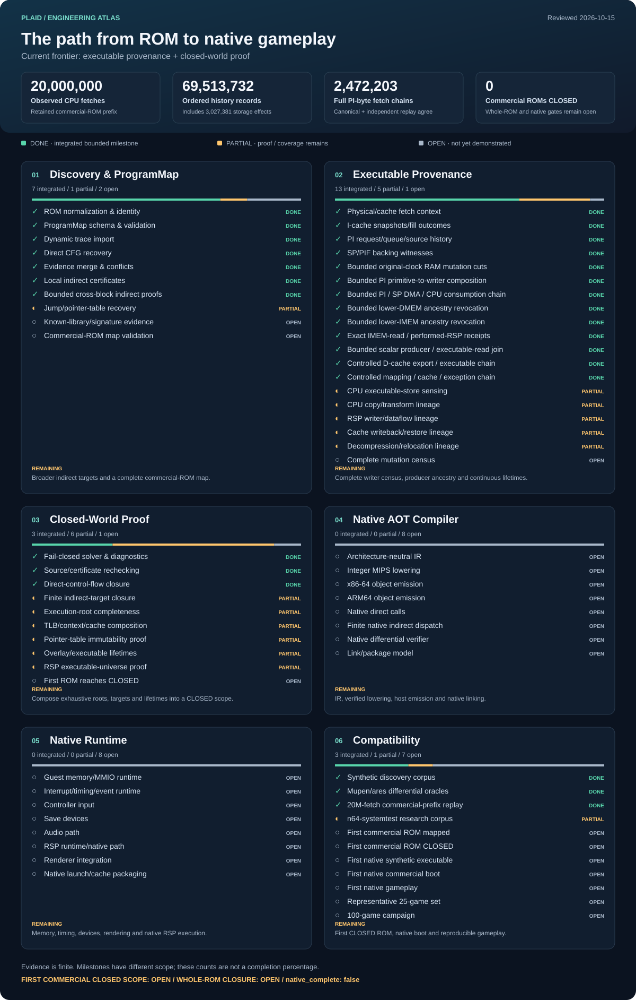

# Plaid

> Experimental Nintendo 64 ROM-to-native recompilation research.

Plaid is exploring whether an **untouched N64 ROM** can be analyzed into a closed executable program, recompiled ahead of time, and packaged as a normal native application.

The end goal is deliberately strict: **final gameplay should not contain a MIPS interpreter, runtime MIPS JIT/dynarec, or hidden instruction fallback.** Emulators and dynarecs are allowed during analysis, instrumentation, and differential verification only.

```text
N64 ROM
  │
  ▼
discover executable code + provenance
  │
  ▼
prove the executable universe is closed
  │
  ▼
MIPS/R4300 → native x86-64 / ARM64
  │
  ▼
N64 compatibility runtime
  │
  ▼
native host application
```

> **Current status:** the discovery/provenance/closure foundation is active and increasingly productionized. The native AOT compiler and native runtime have **not** been implemented yet. No commercial ROM has reached `CLOSED`, and `native_complete` remains `false`.

## Progress

[](docs/PROGRESS.md)

The atlas shows every tracked milestone, each subsystem's remaining work, and retained evidence from the supplied commercial-ROM prefix. It includes the latest integrated RAM-storage, PI/SP/CPU, DMEM, exact RSP-read, cache and mapping compositions.

- **Mint / DONE** — verified and integrated on `main` for the named bounded milestone.
- **Amber / PARTIAL** — implemented or evidenced, with proof or coverage still incomplete.
- **Slate / OPEN** — not implemented or not yet demonstrated.

Counts describe milestone maturity, with different scopes and effort. They are **not an overall completion percentage**. The 20-million-fetch prefix is finite evidence; the first commercial `CLOSED` scope, whole-ROM closure and native gameplay remain open.

The chart is generated from [`docs/progress.json`](docs/progress.json). See [`docs/PROGRESS.md`](docs/PROGRESS.md) for individual states and evidence sources.

## Where the project actually stands

| Area | State | What exists on `main` | What is still missing |
| --- | --- | --- | --- |
| **Discovery & ProgramMap** | strong foundation | ROM normalization, deterministic ProgramMap, dynamic trace import, direct CFG recovery, evidence merge/conflict handling, bounded indirect proofs | broader jump-table proof, known-library evidence, commercial-ROM validation |
| **Executable provenance** | active / partial | physical/cache fetch context, PI/SP/PIF source histories, CPU copy/transform receipts, RSP/CPU mutation evidence, bounded cache/TLB/root provenance | complete mutation census, general lifetimes, full transform/relocation coverage |
| **Closed-world proof** | active / partial | fail-closed solver, source rechecking, static identity hardening, bounded indirect closure, root/TLB/cache proof primitives | complete root census, executable lifetimes, RSP universe closure, first ROM reaching `CLOSED` |
| **Native AOT compiler** | open | design constraints only | IR, MIPS lowering, x86-64/ARM64 emission, native dispatch/linking |
| **Native runtime** | open | architecture boundary only | memory/MMIO, timing/interrupts, input, saves, audio, RSP, rendering, packaging |
| **Compatibility** | research only | synthetic corpus plus pinned Mupen/ares differential oracles | first commercial ROM mapped/closed, native boot/gameplay campaigns |

The important distinction is that Plaid has made substantial progress on **proving what code exists and where it came from**, while the actual native code generator/runtime are intentionally deferred until that proof system is useful enough.

## Why this is hard

A normal static recompiler starts with a known executable image. An N64 ROM can make that assumption fail in several ways:

- code can be copied or DMA'd into RAM before execution;
- overlays can be loaded, relocated, replaced, or aliased;
- indirect branches and pointer tables can depend on runtime state;
- cached instructions can outlive current backing bytes;
- TLB/context changes can reactivate previously resident code;
- CPU, RSP, DMA, decompression, relocation, or patching can produce executable bytes;
- exceptions, interrupts, reset/NMI, and RSP execution add additional roots.

Plaid therefore treats **executable discovery and provenance as a proof problem**, not just a disassembly problem. If an obligation cannot be justified, the system should remain `OPEN` instead of quietly falling back to emulation.

## Core design

Plaid converges evidence from static analysis and instrumented reference implementations into an explicit `ProgramMap`.

That map tracks things such as:

```text
ProgramMap
  ROM / image identity
  executable regions + generations
  basic blocks + direct edges
  indirect sites + target evidence
  overlays + relocations
  executable writes / copies
  RSP microcode identities
  unresolved proof obligations
```

The compiler may use emulators and dynarecs as discovery instruments and behavioral oracles, but those tools are **not** part of the final native gameplay path.

See [`docs/ARCHITECTURE.md`](docs/ARCHITECTURE.md) for the full boundary.

## What is already integrated

The current `main` includes much more than the original M1–M3 prototype:

- deterministic ProgramMap validation, conflict-aware merging, and substantially improved merge scalability;
- pinned Mupen and ares instrumentation/oracles with source-bound replay and complete-source rechecking;
- hardened fail-closed solver behavior for executable identity, raw evidence retention, fetch realizability, and guarded indirect dispatch;
- bounded cross-block indirect-target proofs and pointer-table recovery;
- PI/SP/PIF backing/source histories plus cache/TLB context evidence;
- bounded CPU copy/transform, RSP IMEM/DMEM, and COP1 mutation provenance;
- exception/root primitives including BEV/PIF, NMI, cached handler-generation, interrupt/watch-related proof obligations;
- durable integration receipts documenting what each promoted research result proves and, just as importantly, what it does **not** prove.

For exact engineering scope and remaining uncertainty, use [`docs/STATUS.md`](docs/STATUS.md), [`docs/NEXT.md`](docs/NEXT.md), and [`docs/DECISIONS.md`](docs/DECISIONS.md).

## Repository layout

| Path | Purpose |
| --- | --- |
| [`crates/plaid-core/`](crates/plaid-core/) | core ProgramMap, discovery, provenance, solver, and proof logic |
| [`apps/plaid/`](apps/plaid/) | command-line interface |
| [`docs/`](docs/) | architecture, status, decisions, roadmap, and progress data |
| [`research/`](research/) | durable research notes and integration receipts |
| [`spikes/`](spikes/) | bounded reference experiments and adversarial fixtures |
| [`instruments/`](instruments/) | instrumentation kept separate from production logic |
| [`experiments/`](experiments/) | independent models/oracles used to validate assumptions |
| [`refs.lock.toml`](refs.lock.toml) | exact pinned external reference revisions |

## Build and local verification

Plaid is a Rust workspace. The canonical checks are intended to run **locally**:

```bash
cargo fmt --all -- --check
cargo clippy --locked --workspace --all-targets -- -D warnings
cargo test --locked --workspace
python scripts/test_cli.py
python tools/progress.py --check
```

GitHub Actions is kept **manual-only**; ordinary pushes do not need hosted CI.

Reference experiments may require Linux/WSL, Python, GCC/Clang, NASM, and locally fetched pinned repositories under `.refs/`.

Detailed setup, CLI commands, reference-lab notes, and research consumers live in [`docs/DEVELOPMENT.md`](docs/DEVELOPMENT.md).

## Ground rules

- No ROMs, copyrighted game assets, firmware blobs, keys, or proprietary Nintendo code belong in git.
- No hidden interpreter/JIT fallback is allowed in a claimed native-complete path.
- Unknown provenance stays unknown.
- Finite traces do not prove exhaustive coverage by themselves.
- Equal bytes do not prove equal provenance or lifetime.
- Game-specific hacks do not count as universal discovery.
- Compiler transforms require independent verification.
- `native_complete` must stay `false` until the required closure obligations are actually proven.

## Project documents

| Document | Use it for |
| --- | --- |
| [`docs/PROGRESS.md`](docs/PROGRESS.md) | auditable milestone states |
| [`docs/STATUS.md`](docs/STATUS.md) | what is currently implemented |
| [`docs/NEXT.md`](docs/NEXT.md) | current engineering priorities and open obligations |
| [`docs/ARCHITECTURE.md`](docs/ARCHITECTURE.md) | product/compiler/runtime boundary |
| [`docs/PLAN.md`](docs/PLAN.md) | long-term development plan |
| [`docs/DECISIONS.md`](docs/DECISIONS.md) | architecture decision log |
| [`docs/SOURCES.md`](docs/SOURCES.md) | external references and provenance |
| [`docs/DEVELOPMENT.md`](docs/DEVELOPMENT.md) | build, CLI, local validation, and reference-lab details |
| [`AGENTS.md`](AGENTS.md) | implementation rules for automated workers |
| [`ORCHESTRATION.md`](ORCHESTRATION.md) | swarm coordination and integration protocol |

Plaid is still a research project. The interesting part is no longer “can we decode some MIPS?” It is whether the project can **earn a closed executable universe without cheating**, and only then turn that universe into a native program.
