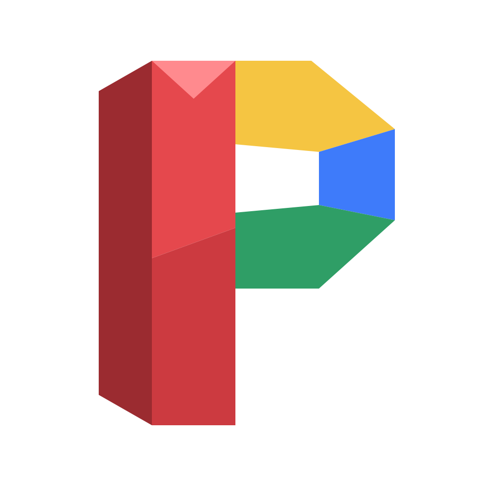

<div align="center">



# Plaid

**Turns N64 ROMs into native PC programs, automatically.**

[](docs/HISTORY.md) [](docs/PROGRESS.md) [](docs/STATUS.md)

</div>

> 🚧 **Work in progress.** Lots of games boot and play for a while, but nothing is finished yet.
> The full progress report is in [`docs/REPORT.md`](docs/REPORT.md).

## What it does

Plaid reads an N64 ROM, finds its code, and compiles it to native x86-64 code. The finished game runs that native code directly: no emulator and no interpreter. Graphics go through [RT64](https://github.com/rt64/rt64).

Games tried so far: Super Mario 64, Ocarina of Time, Majora's Mask, F-Zero X, Banjo-Kazooie, Paper Mario, Mario Kart 64, Star Fox 64, Rogue Squadron, Mario Party 2 and GoldenEye (GoldenEye doesn't build yet).

## Try it

You supply your own ROM; ROMs are never committed.

```powershell
python scripts/native.py <your rom> --rt64
```

This builds the game and writes a `Play <name>.cmd` launcher beside it. Only Windows is tested.

## Build and test

```bash
cargo test --locked --workspace
python scripts/test_cli.py
```

More in [`docs/DEVELOPMENT.md`](docs/DEVELOPMENT.md).

## Learn more

[Progress report](docs/REPORT.md) · [Status](docs/STATUS.md) · [Next steps](docs/NEXT.md) · [Architecture](docs/ARCHITECTURE.md) · [Decisions](docs/DECISIONS.md) · [Credits](docs/REPORT.md#credits)

## License

MIT or Apache-2.0, at your option. Plaid is not affiliated with Nintendo.
