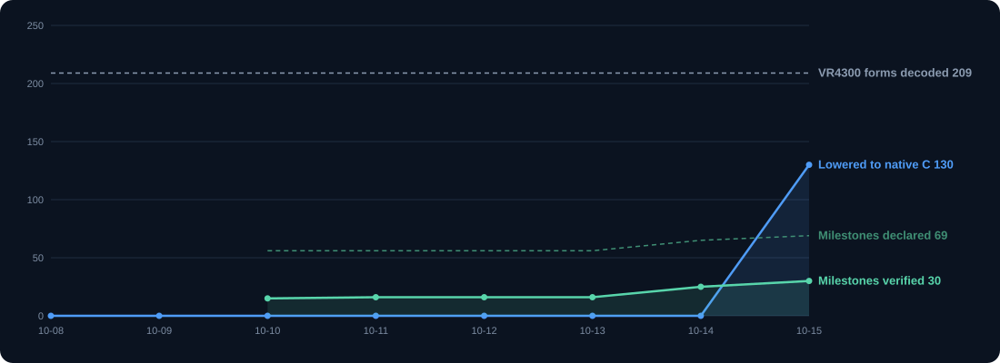

# Plaid progress history

One point per day, generated from [`history.json`](history.json) by [`tools/progress.py`](../tools/progress.py). Hover a point in the SVG for exact numbers.

- **VR4300 forms lowered** — instruction forms of the pinned decoder that the VR4300 implements (pseudo-instructions and non-VR4300 forms excluded), counted as lowered only when a program using the form passes discovery, the guarded-scope solver and `plaid-lower` (`plaid isa-coverage`). Before `crates/plaid-lower` existed the count is 0 by construction.
- **Milestones** — states in [`progress.json`](progress.json) at the last `main` commit of the day. The declared total grows as milestones are added; it is not a completion percentage.

| Date | VR4300 forms lowered | % | Milestones verified | partial | declared |
| --- | --- | --- | --- | --- | --- |
| 2026-10-15 | 196/209 | 93.8% | 30 | 26 | 69 |
| 2026-10-14 | 0/209 | 0.0% | 25 | 13 | 65 |
| 2026-10-13 | 0/209 | 0.0% | 16 | 13 | 56 |
| 2026-10-12 | 0/209 | 0.0% | 16 | 13 | 56 |
| 2026-10-11 | 0/209 | 0.0% | 16 | 13 | 56 |
| 2026-10-10 | 0/209 | 0.0% | 15 | 11 | 56 |
| 2026-10-09 | 0/209 | 0.0% | — | — | — |
| 2026-10-08 | 0/209 | 0.0% | — | — | — |

Back to the [progress map](PROGRESS.md) and the [status page](STATUS.md).
